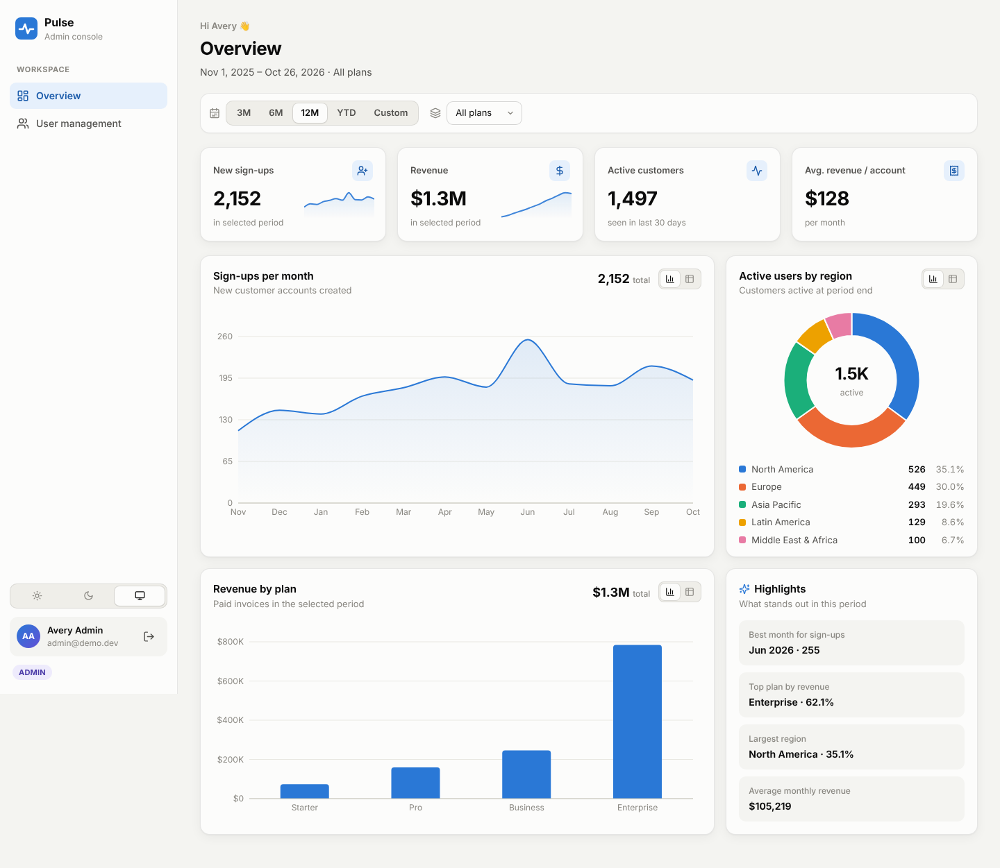
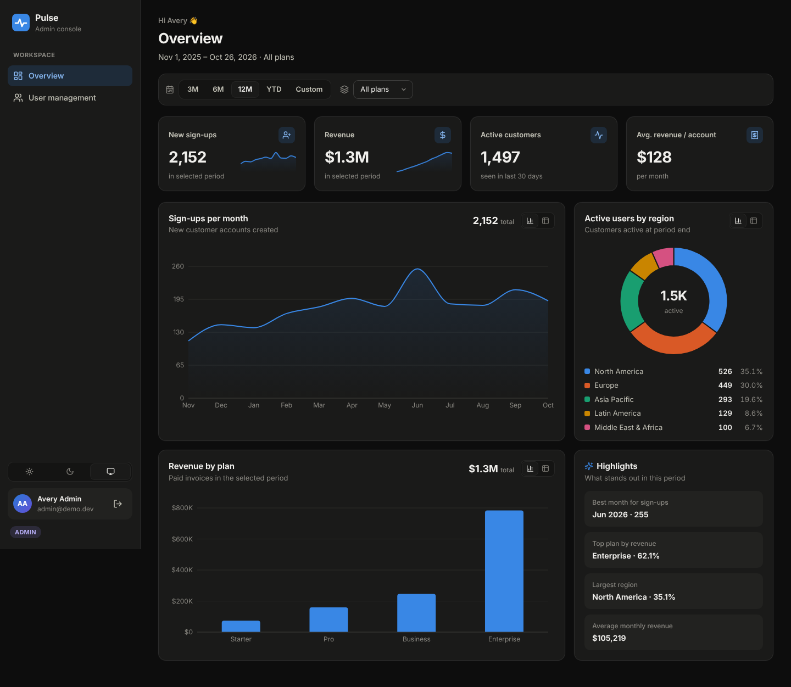
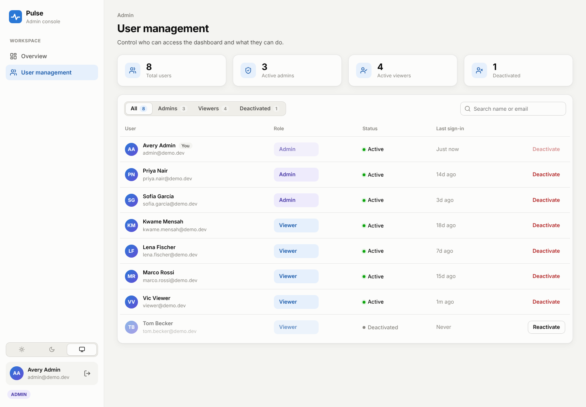

# Pulse · SaaS Admin Dashboard

A polished admin dashboard for a SaaS business: sign-up, revenue, and engagement analytics
with role-based access and user management.

**Stack:** React 19 + TypeScript + Recharts (Vite) · Node.js + Express 5 · SQLite via Prisma · Vitest + Supertest



| Dark theme | User management |
|---|---|
|  |  |

## Demo accounts

| Role | Email | Password | Can do |
|---|---|---|---|
| **Admin** | `admin@demo.dev` | `Admin123!` | Everything, including user management |
| **Viewer** | `viewer@demo.dev` | `Viewer123!` | Read-only dashboard. Opening User management shows an access-denied screen |

The login page has one-click buttons that fill in these accounts. The seed also creates six
more staff users (password `Demo1234!`), one of them deactivated, so the user management page
has realistic content.

## Features

- **Secure login**: bcrypt-hashed passwords; a signed session in an HTTP-only, SameSite cookie;
  login rate limiting; sessions revoked instantly on deactivation.
- **Two roles**: *admin* (full access) and *viewer* (read-only). Enforced in the API on every
  request, and reflected in the UI with a locked nav item and an access-denied page.
- **Dashboard**
  - KPI tiles: new sign-ups, revenue, active customers, average revenue per account, with
    sparklines and trend vs the previous period.
  - Sign-ups per month (line), revenue by plan (bar), active users by region (donut).
  - Every chart has hover tooltips and a **table view** toggle for accessibility.
  - A highlights panel that calls out the best month, top plan, and largest region.
- **Filters**: date range presets (3M, 6M, 12M, YTD) or a custom range, plus plan. All charts
  update together, and filters live in the URL so a view can be bookmarked or shared.
- **User management** (admin only): search, filter by role or status, change roles, and
  deactivate or reactivate users with confirmation and toasts. Guard rails stop admins from
  locking themselves out or removing the last admin.
- **Polish**: sidebar layout, light, dark, and system themes, responsive down to phone width
  (the sidebar becomes a drawer), skeleton loading states, and empty and error states with retry.
- **Realistic seed data**: 12 months of deterministic data with ~7.5% monthly growth,
  seasonality, a campaign spike, trials, upgrades, churn, and five regions (~2,200 customers,
  ~10,000 invoices).

## Getting started

Requires Node.js 20 or newer.

```bash
npm install
cp server/.env.example server/.env   # SQLite path + session secret
npm run setup                        # create the database and seed it
npm run dev                          # API on :4000, web app on http://localhost:5173
```

Re-seed at any time with `npm run seed`.

### Scripts

| Command | What it does |
|---|---|
| `npm run dev` | Runs API and web app with hot reload |
| `npm run setup` | Creates the SQLite schema and seeds demo data |
| `npm run seed` | Wipes and re-seeds the database |
| `npm test` | Runs the API test suite |
| `npm run typecheck` | Type-checks server and client |
| `npm run build` | Production build (seeded demo DB plus static client), as used by Netlify |

## Tests

```bash
npm test
```

29 tests across three suites run against a throwaway SQLite database:

- **`auth.test.ts`**: successful login sets an HTTP-only cookie; wrong password and unknown
  email give the same 401; validation; deactivated accounts are refused; passwords are stored
  as bcrypt hashes; tampered and expired cookies are rejected; logout.
- **`roles.test.ts`**: anonymous users get 401; viewers get 403 on user listing and updates;
  admins can list and update; role changes apply on the next request; deactivation signs the
  user out; admins can't demote themselves.
- **`metrics.test.ts`**: chart API shape and defaults; series totals match the KPIs; date
  range and plan filters match direct database counts; zero-filled empty ranges; invalid
  filters get 400; authentication is required.

## Deploying to Netlify

The repo is ready for Netlify: `netlify.toml` builds the React app as a static site and runs
the Express API as a Netlify Function at `/api/*`.

1. In Netlify choose **Add new site → Import an existing project** and pick this repository.
   The build settings come from `netlify.toml`, so leave them as they are.
2. Under **Site configuration → Environment variables**, add `SESSION_SECRET` with a long
   random string (for example the output of `openssl rand -hex 32`).
3. Deploy. Every push to `main` redeploys automatically.

> **About the database on Netlify:** Netlify Functions have no persistent disk, so the build
> ships a freshly seeded SQLite file and each function instance works on its own copy. The
> dashboard and demo logins always work. Changes made in User management last until the
> function restarts and then reset to the seed, which suits a client demo. For durable data,
> use a hosted database (see [docs/ARCHITECTURE.md](docs/ARCHITECTURE.md#deployment-on-netlify)).

## Architecture

See **[docs/ARCHITECTURE.md](docs/ARCHITECTURE.md)** for the data model, metric definitions,
auth flow, and API reference.
